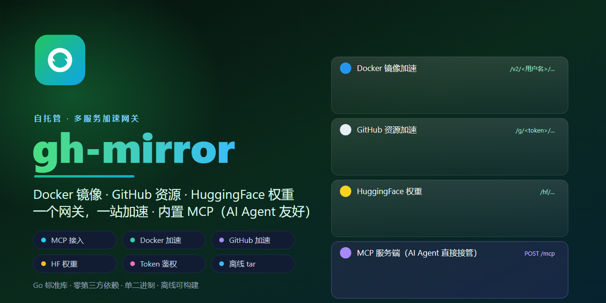

<p align="center">
  <a href="https://github.com/yufeng8/gh-mirror">
    
  </a>
</p>

<h1 align="center">
  
  gh-mirror
</h1>

> 自托管的 GitHub 资源镜像加速服务 · Token 鉴权 · Web 管理后台 · 完全私有化部署
> Self-hosted GitHub mirror / raw / release acceleration proxy with token auth and admin dashboard

<p align="center">
  <a href="README_EN.md">English</a> | <strong>中文</strong>
</p>

[](https://github.com/yufeng8/gh-mirror/releases)
[](https://github.com/yufeng8/gh-mirror/pkgs/container/gh-mirror)
[](https://github.com/yufeng8/gh-mirror/actions/workflows/docker.yml)
[](https://github.com/yufeng8/gh-mirror/actions/workflows/build.yml)
[](./LICENSE)
[](https://github.com/yufeng8/gh-mirror/stargazers)

**gh-mirror** 是一个开源的、可完全私有化部署的 **GitHub 资源镜像加速服务**。在域名后拼接 `/g/<token>/` + 完整 GitHub 地址即可加速下载，浏览器与命令行（curl/wget）通用；后端为 Go 标准库实现的流式反向代理，自带磁盘缓存与 `Range` 断点续传，并内置 Web 管理后台与 Token 鉴权。

> 文档示例部署域名为 `mirror.example.com`，请替换为你自己的域名。

## English

**gh-mirror** is a lightweight, fully self-hostable GitHub resource mirror / acceleration proxy. Prepend `/g/<token>/` to your domain in front of any full GitHub URL to speed up downloads for both browsers and CLIs (`curl` / `wget`). The backend is a streaming reverse proxy built with the Go standard library, featuring on-disk caching with `Range` resume support, a built-in web admin dashboard, and per-token access control.

### Highlights
- **Token auth** — every proxied URL carries its own token; unauthorized requests return 404.
- **Usage stats** — per-token hit counts, traffic, and last-seen, persisted to `tokens.json`.
- **Admin UI** — manage tokens and view stats from a clean web dashboard.
- **Smart cache** — caches `GET`s to reduce upstream load; serializes concurrent fetches to avoid the thundering herd.
- **Multi-protocol rewrite** — `raw.githubusercontent.com` / `github.com` / `releases` / `archive` all routed through gh-mirror.
- **One-click deploy** — ships `deploy.sh`, `Dockerfile`, a systemd unit, and an nginx reverse-proxy config.

> ⚠️ **合规与免责声明（请先读）**：本项目仅用于加速你**有权访问**的 GitHub 资源。严禁用于盗用他人私有仓库、规避付费、绕过访问限制或任何违反 GitHub 服务条款及所在地法律法规的行为。使用者须自行承担因不当使用产生的全部责任；本项目不缓存或记录请求内容，亦不对加速资源的版权与合规性负责。详见文末 [合规与免责声明](#合规与免责声明)。

## 为什么需要它（解决的实际痛点）

- **拉取慢 / 超时**：国内或受限网络访问 GitHub 常常很慢、频繁超时、下载中断。把服务部署在能顺畅访问 GitHub 的节点，对内提供高速回源与本地缓存。
- **CI/CD 不稳定**：构建机拉依赖、下载 Release 经常被 GitHub 限流或超时打断。用本服务做统一加速入口，构建更稳。
- **jsDelivr 有局限**：`cdn.jsdelivr.net/gh/...` 仅加速公开仓库源码、单文件约 20MB，且不支持 Releases / archive / API。本项目覆盖全场景。
- **怕被滥用**：公共代理不可控。本项目所有请求必须携带后台下发的 Token，无效即 404，访问可控、可审计。
- **不想依赖第三方**：希望流量与令牌完全自持、不经过任何公开代理。一键部署到自己的服务器即可。

## 核心特性

- **完全私有化部署**：原生 / Docker 一键部署到你的服务器，数据自持，不经过任何第三方。
- **Token 鉴权**：后台签发 Token，所有代理请求必须携带有效 Token，无效返回 404，避免被当作开放代理滥用。
- **全场景加速**：覆盖仓库文件（blob/raw）、Raw 文件、Releases 二进制、仓库打包（archive）、以及短链（`gh/...`）。
- **流式反向代理 + 磁盘缓存 + Range 断点续传**：基于 Go 标准库实现，性能与原生部署基本持平。
- **Web 管理后台**：可视化查看 / 新增 / 删除 Token，并直接给出该实例的代理示例地址。
- **一键部署**：原生（`native`）/ Docker 两种模式，`deploy.sh` 与 `install.sh` 开箱即用。
- **多架构 Docker 镜像**：自动构建并发布到 GitHub Container Registry（amd64 / arm64），且 **CI 自动设为 Public**，匿名 `docker pull` 即用。

## 目录

- [访问规则](#访问规则核心变更)
- [管理后台](#管理后台)
- [关于 jsDelivr `gh`](#关于-jsdelivr-gh)
- [本地构建](#本地构建)
- [一键部署（Ubuntu 24.04）](#一键部署ubuntu-2404)
- [一键安装（从 GitHub Release）](#一键安装从-github-release无需源码)
- [Docker 镜像（GHCR 自动构建）](#docker-镜像ghcr-自动构建)
- [手动部署](#手动部署ubuntu-2404)
- [缓存清理](#缓存清理)
- [环境变量](#环境变量)
- [安全说明](#安全说明)
- [合规与免责声明](#合规与免责声明)
- [许可证](#许可证)
- [⭐ Star & Fork 指引](#-star--fork-指引)

## 访问规则（核心变更）

所有代理请求都**必须携带有效 token**，格式为：

```
https://mirror.example.com/g/<token>/<完整 GitHub 地址>
```

| 场景 | 访问地址 |
|------|----------|
| 仓库文件（blob/raw 页面） | `https://mirror.example.com/g/<token>/https://github.com/owner/repo/blob/main/path/file.txt` |
| Raw 文件 | `https://mirror.example.com/g/<token>/https://raw.githubusercontent.com/owner/repo/main/file.txt` |
| Releases 二进制 | `https://mirror.example.com/g/<token>/https://github.com/owner/repo/releases/download/v1.0/app.zip` |
| 仓库打包 | `https://mirror.example.com/g/<token>/https://github.com/owner/repo/archive/refs/heads/main.zip` |
| 短链 | `https://mirror.example.com/g/<token>/gh/owner/repo/raw/main/file.txt` |

**未携带有效 token（或 token 不在后台）的请求一律返回 404。** 之前的「直接拼接 GitHub 地址」写法已不再可用。

命令行：
```bash
curl -L -o app.zip "https://mirror.example.com/g/<token>/https://github.com/owner/repo/releases/download/v1.0/app.zip"
```

响应头 `X-Cache: HIT` 表示命中本地缓存，`MISS` 表示回源。

## 管理后台

- 默认路径 `/admin`（可用环境变量 `ADMIN_PATH` 自定义）。
- 默认账号 / 密码：`admin` / `admin`（部署时可设置，密钥与凭据写入 `/etc/gh-mirror.env`）。
- 登录后凭**签名 Session Cookie**（HMAC 校验 + 7 天过期）保持会话。
- 后台能力：
  - 查看 / 新增 / 删除 Token（新增时可留空 token 自动生成随机值，并填写备注）。
  - 页面直接给出该实例的代理示例地址。

首页（`/`）为公开展示代理使用说明，不暴露后台路径以外的内容。

## 关于 jsDelivr `gh`

`cdn.jsdelivr.net/gh/用户/仓库@分支/路径` 能加速，但**仅限公开仓库源码文件**、单文件约 20MB、
且吃不下任意 GitHub 地址（releases / archive / API 不行）。本项目默认直连回源覆盖全场景；
如需用 jsDelivr 边缘缓存省服务器带宽，可设 `USE_JSDELIVR=1`（仅对 blob/raw 生效）。

## 本地构建

```bash
# 在 Windows 上交叉编译到 Linux（目标架构如 arm64 / amd64）
set GOOS=linux
set GOARCH=arm64
go build -o gh-mirror .
```

## 一键部署（Ubuntu 24.04）

把整个项目目录上传到服务器，然后以 root 运行：

```bash
sudo bash deploy.sh
```

脚本会交互询问**域名**、**证书邮箱**、**部署方式**，以及**管理员密码**（默认 `admin`），并自动生成会话密钥；随后自动完成安装。

- `native`（默认）：安装 Go → 编译 → 建用户/目录（含 token 数据目录）→ 注册 systemd 服务 → 配置 nginx → 防火墙 → 申请证书。
- `docker`：安装 Docker → 构建镜像（按架构）→ 以 `--network=host` + 缓存卷 + 数据卷启动容器 → 配置 nginx → 防火墙 → 申请证书。

> 容器模式用 host 网络规避网桥 NAT 开销、缓存与 token 数据挂卷避免写入 overlay 层，性能与原生基本持平。
> 资源受限的小内存实例（如 1GB）建议选 `native`（省去 Docker 守护进程约 100–200MB 内存）。

前置要求：域名 A 记录已指向本机公网 IP，且 80/443 已放行。

## 一键安装（从 GitHub Release，无需源码）

适合全新服务器、不想上传项目源码的场景：脚本自动连 GitHub 拉取最新预编译二进制并完成服务与反代配置。

```bash
# 交互式（会询问域名 / 邮箱 / 密码）
bash <(curl -fsSL https://raw.githubusercontent.com/yufeng8/gh-mirror/main/install.sh)

# 非交互 / 一行搞定
DOMAIN=mirror.example.com EMAIL=you@example.com ADMIN_PASS='你的密码' \
  bash <(curl -fsSL https://raw.githubusercontent.com/yufeng8/gh-mirror/main/install.sh)
```

可选环境变量：

| 变量 | 说明 |
|------|------|
| `MODE` | `native`(默认) / `docker` |
| `VERSION` | 原生模式指定版本标签（如 `v1.0.0`），默认取最新；Docker 模式指定镜像标签（默认 `latest`），`DOCKER_BUILD=1` 时则为源码分支/标签（默认 `main`） |
| `DOCKER_BUILD` | 仅 Docker 模式：设为 `1` 时从 GitHub 源码现场构建镜像（而非拉取 GHCR 现成镜像） |
| `GITHUB_TOKEN` | **私有仓库必填**：具备 `repo`(读) + `read:packages` 权限的 PAT，用于拉取脚本/Release、登录 GHCR 拉取私有镜像 |
| `GHCR_USER` | GHCR 登录用户名（默认 `yufeng8`），填与 `GITHUB_TOKEN` 对应账号一致即可 |
| `GH_PROXY` | 下载加速前缀（如 `https://ghproxy.com/`），国内服务器可用 |
| `SKIP_NGINX=1` | 只装服务、不配置 nginx/TLS（自行反代时） |
| `ADMIN_USER` / `ADMIN_PATH` | 自定义后台账号 / 路径 |

脚本流程（原生模式）：检测架构 → 下载 `gh-mirror-linux-<arch>` → 建用户/目录 → 写 `/etc/gh-mirror.env` → 注册 systemd 服务 →（默认）装 nginx + 申请证书 + 放通防火墙 → 配置缓存定时清理 → 自检。

> **私有仓库 / 私有 Fork 场景**：官方仓库 `yufeng8/gh-mirror` 本身是**公开**的，上面的 `curl ... | bash` 一行安装即可直接使用，无需任何 Token。
> 若你将本项目 **fork 到私有仓库**后部署，则 `raw.githubusercontent.com` 与 Release 都需要鉴权，请改用以下带令牌的方式（令牌会留在服务器上，请确保 PAT 仅授予必要权限）：
>
> ```bash
> GITHUB_TOKEN=ghp_xxx bash -c "$(curl -fsSL -H \"Authorization: Bearer $GITHUB_TOKEN\" \
>   https://raw.githubusercontent.com/yufeng8/gh-mirror/main/install.sh)"
> ```
>
> 该命令用令牌拉取脚本并以相同令牌运行；脚本内部会：带 `Authorization` 头查询/下载 Release（原生模式）、用 `docker login ghcr.io` 登录拉取私有镜像（Docker 模式）。
>
> **PAT 所需权限（scope）**：
> - `repo`（内容读取）：私有仓库下脚本拉取、`gh_curl` 查询/下载 Release，以及 `DOCKER_BUILD=1` 源码克隆都需要它。
> - `read:packages`：登录 GHCR 拉取**私有**镜像必需（公开镜像可匿名拉取，无需此项）。
>
> **脚本会做权限自检**：运行时会调用 GitHub API 读取令牌的 `X-OAuth-Scopes`，提前提示是否缺少上述 scope；若 `docker login` 失败，会明确点出「最可能缺 `read:packages`」并打印原始错误，而不是笼统报 401。权限不足时请重新生成 PAT 勾选对应 scope 后重跑。

### Docker 模式

若服务器想用 Docker，加 `MODE=docker` 即可（脚本会自动安装 Docker、从 GHCR 拉取现成镜像运行容器，仍由 nginx 反代；私有仓库记得带 `GITHUB_TOKEN`）：

```bash
MODE=docker DOMAIN=mirror.example.com EMAIL=you@example.com ADMIN_PASS='你的密码' \
  bash <(curl -fsSL https://raw.githubusercontent.com/yufeng8/gh-mirror/main/install.sh)
```

### 卸载

```bash
bash <(curl -fsSL https://raw.githubusercontent.com/yufeng8/gh-mirror/main/uninstall.sh)
# 连数据(token/缓存/用户)一起删: 加 --purge；跳过确认: 加 -y
```

### Docker 镜像（GHCR 自动构建）

仓库已配置 GitHub Actions（`.github/workflows/docker.yml`）：推送 `main` 自动打 `latest`，打 `v*` 标签（如 `v1.0.0`）自动打同名标签，并推送**多架构镜像（amd64/arm64）**到 GitHub Container Registry：

```
ghcr.io/yufeng8/gh-mirror:latest
ghcr.io/yufeng8/gh-mirror:v1.0.0
```

镜像在每次构建后会被 **CI 自动设为 Public**（见 `docker.yml` 末尾的「Set package visibility to public」步骤），因此匿名服务器可直接拉取，无需登录：

```bash
docker pull ghcr.io/yufeng8/gh-mirror:latest
```

`install.sh` 的 `MODE=docker` **默认直接拉取该公开镜像**，无需在服务器上编译源码：

```bash
MODE=docker DOMAIN=mirror.example.com EMAIL=you@example.com ADMIN_PASS='xxx' \
  bash <(curl -fsSL https://raw.githubusercontent.com/yufeng8/gh-mirror/main/install.sh)
# 指定版本: MODE=docker VERSION=v1.0.0 ...
# 改用源码现场构建(兜底): MODE=docker DOCKER_BUILD=1 ...
```

> 备注：若你 **fork 到私有仓库**自行构建，CI 默认不会公开 Package；此时需到 Packages 设置手动改为 Public，或用 `gh api --method PATCH "user/packages/container/<你的包名>/visibility" -f visibility=public`（需 `write:packages` 权限的 PAT）。

## 手动部署（Ubuntu 24.04）

1. **域名解析**：`mirror.example.com` A 记录指向服务器公网 IP；安全组放行 80/443。

2. **准备目录与用户**：
   ```bash
   sudo useradd -r -s /usr/sbin/nologin ghmirror
   sudo mkdir -p /opt/gh-mirror /var/cache/gh-mirror /var/lib/gh-mirror
   sudo chown -R ghmirror:ghmirror /var/cache/gh-mirror /var/lib/gh-mirror
   ```

3. **上传二进制**：把 `gh-mirror` 传到 `/opt/gh-mirror/gh-mirror` 并 `chmod +x`，属主 `ghmirror`。

4. **写入配置**（`/etc/gh-mirror.env`，权限 600）：
   ```bash
   sudo tee /etc/gh-mirror.env >/dev/null <<'EOF'
   ADMIN_USER=admin
   ADMIN_PASS=admin
   ADMIN_PATH=/admin
   ADMIN_SECRET=$(openssl rand -hex 32)
   COOKIE_SECURE=true
   TOKENS_FILE=/var/lib/gh-mirror/tokens.json
   LISTEN=127.0.0.1:8080
   CACHE_DIR=/var/cache/gh-mirror
   CACHE_TTL_MINUTES=1440
   MAX_CACHE_MB=200
   UPSTREAM_TIMEOUT=60
   EOF
   sudo chmod 600 /etc/gh-mirror.env
   ```

5. **注册服务**：
   ```bash
   sudo cp gh-mirror.service /etc/systemd/system/
   sudo systemctl daemon-reload
   sudo systemctl enable --now gh-mirror
   sudo systemctl status gh-mirror
   ```

6. **nginx**：
   ```bash
   sudo cp nginx/gh-mirror.conf /etc/nginx/sites-available/
   sudo ln -s /etc/nginx/sites-available/gh-mirror.conf /etc/nginx/sites-enabled/
   sudo nginx -t && sudo systemctl reload nginx
   ```

7. **HTTPS（Let's Encrypt）**：
   ```bash
   sudo apt install -y certbot python3-certbot-nginx
   sudo certbot --nginx -d mirror.example.com
   ```

8. **登录后台添加 Token**：访问 `https://mirror.example.com/admin`，用 admin/admin 登录后新增 token，之后即可用 `/g/<token>/...` 访问。

## 缓存清理

缓存按 TTL（默认 1 天）过期，但文件不会自动删除。`deploy.sh` 会在部署时**自动配置**定时清理：

- 原生模式：写入 `/etc/cron.d/gh-mirror`，每天 04:10 删除 `${CACHE_DIR}` 中 7 天前的缓存文件，以及 1 天前的 `.tmp` 残留。
- 容器模式：同样写入 `/etc/cron.d/gh-mirror`，每天 04:10 启动一次性 `busybox` 容器挂载命名卷 `gh-mirror-cache` 清理 7 天前的缓存。

如需手动调整，直接编辑 `/etc/cron.d/gh-mirror` 即可。

## 环境变量

| 变量 | 默认 | 说明 |
|------|------|------|
| `LISTEN` | `127.0.0.1:8080` | 监听地址（仅本机，由 nginx 反代） |
| `CACHE_DIR` | `./cache` | 缓存目录 |
| `CACHE_TTL_MINUTES` | `1440` | 缓存有效期（分钟） |
| `MAX_CACHE_MB` | `200` | 单文件超过此大小不缓存 |
| `UPSTREAM_TIMEOUT` | `60` | 回源超时（秒） |
| `USE_JSDELIVR` | `0` | 设为 `1` 让 blob/raw 走 jsDelivr 边缘缓存 |
| `ADMIN_PATH` | `/admin` | 管理后台路径（可自定义，必须以 `/` 开头） |
| `ADMIN_USER` | `admin` | 管理员账号 |
| `ADMIN_PASS` | `admin` | 管理员密码 |
| `ADMIN_SECRET` | 随机 | 会话签名密钥（建议通过环境变量固定，重启不致失效） |
| `COOKIE_SECURE` | `true` | 会话 Cookie 是否带 Secure 标记（HTTPS 下保持 true） |
| `TOKENS_FILE` | `./tokens.json` | Token 持久化文件路径 |

## 安全说明

- 仅允许回源到 GitHub 相关域名（白名单见 `rewrite.go`），不会被当作开放代理滥用。
- 代理请求必须携带后台下发的 token，无效 token 返回 404；**Token 列表等同于访问凭证，请妥善保管 `tokens.json` 与 `ADMIN_SECRET`**。
- 管理后台登录使用恒定时间比较，Session Cookie 经 HMAC 签名且 HttpOnly + SameSite=Strict。
- 如需进一步加固，可在 nginx 层对 `/admin` 增加访问限制或 Basic Auth，并定期更换管理员密码。

## 合规与免责声明

- 本项目是**中立的技术工具**，仅用于加速你**有权访问**的 GitHub 资源。
- **严禁**用于以下行为，使用者自行承担全部法律责任：
  - 盗用、抓取你不拥有或不被授权访问的私有仓库 / 私有资源；
  - 规避付费、绕过厂商访问限制或付费墙；
  - 任何违反 GitHub [服务条款](https://docs.github.com/site-policy/github-acceptable-use-policies) 及你所在地法律法规的行为；
  - 将本服务作为开放代理对外提供、用于攻击或滥用。
- 本项目**不缓存、不记录**请求的具体内容；加速资源的版权与合规性由使用者负责。
- 若你所在网络/地区访问 GitHub 受限，请优先确认本地法规允许的前提下使用。

## 许可证

本项目以 **MIT License** 开源。详见 [LICENSE](./LICENSE)。

你可以自由使用、修改、分发本软件，包括商业用途；请保留版权声明与许可声明。软件按「原样」提供，不提供担保。

## ⭐ Star & Fork 指引

如果这个项目帮你省下了时间、或解决了实际的下载痛点，欢迎在 GitHub 上支持一下：

- ⭐ **点个 Star**：<https://github.com/yufeng8/gh-mirror> —— 让更多人能通过搜索发现它，也是对作者持续维护的动力。
- 🍴 **Fork 一份**：<https://github.com/yufeng8/gh-mirror/fork> —— 想加功能、改界面、适配内网，全都可以从 Fork 开始。
- 🐛 **提 Issue / PR**：发现问题或好点子，欢迎到 <https://github.com/yufeng8/gh-mirror/issues> 交流。

> 小提示：在部署好的首页（`/`）底部也放了「Star on GitHub」按钮，方便随时回来点星。

---

© 2026 gh-mirror · MIT License
